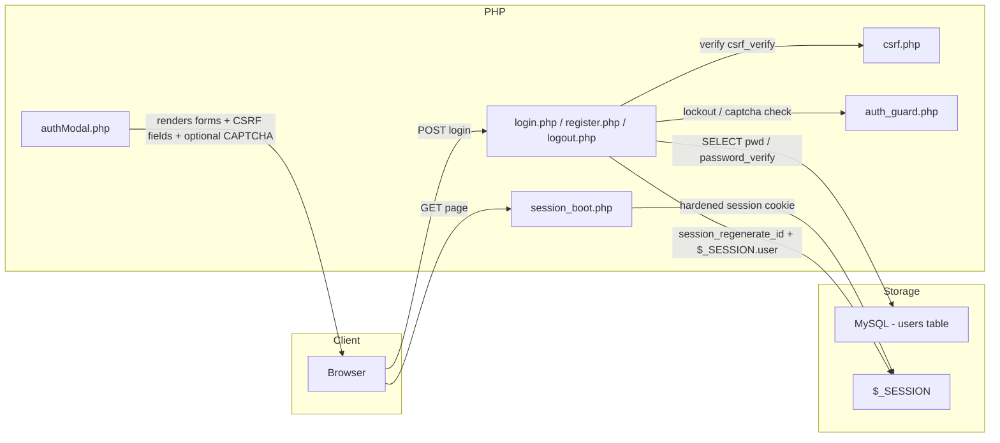
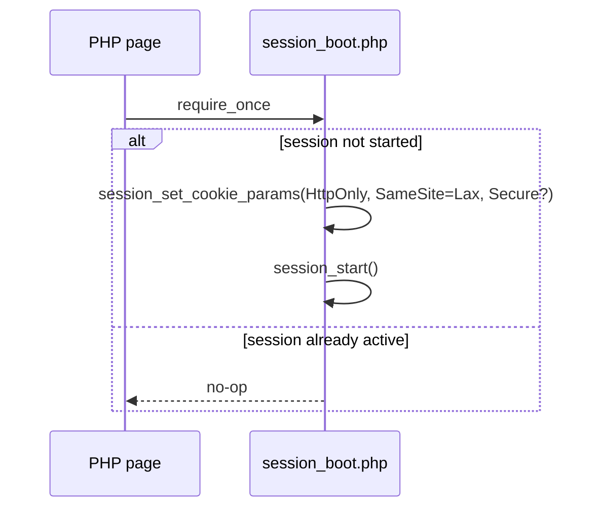
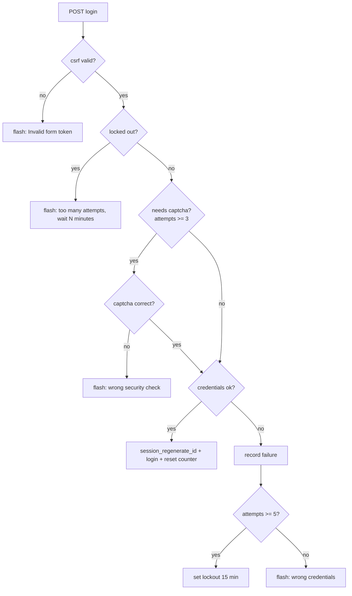

# MythiFox — Authentication Security

This document describes the security layer added to the login, sign-up, and session handling of MythiFox. It complements `feat/login-modal` (the animated modal UI) with the server-side protections described here.

## Overview

The authentication flow previously accepted weak passwords, had no protection against brute-force login attempts, was vulnerable to CSRF, and did not rotate session IDs after login. The following countermeasures are now in place:

| Threat | Countermeasure | Where |
|---|---|---|
| Weak passwords | Sign-up policy: ≥ 8 chars, at least one letter and one number | `register.php` |
| Brute-force login | Failed-attempt tracking → math CAPTCHA after 3 fails → 15-minute lockout after 5 fails | `auth_guard.php` |
| Cross-site request forgery | CSRF token on login, sign-up and logout forms | `csrf.php` |
| Session fixation | `session_regenerate_id(true)` on login and sign-up | `login.php`, `register.php` |
| Cookie exfiltration / hijacking | `HttpOnly` + `SameSite=Lax` + `Secure` (when HTTPS) session cookies | `session_boot.php` |
| Session ID guessing | PHP strict session mode | `session_boot.php` |

## Architecture

## Session bootstrap (`session_boot.php`)

All entry points start their session through this single include instead of calling `session_start()` directly. Before starting the session it:

1. Sets cookie flags — `HttpOnly`, `SameSite=Lax`, and `Secure` when the request is HTTPS.
2. Keeps the session cookie lifetime at `0` (browser session).

The include is idempotent: if a session already exists, it does nothing, so `header.php`, `sidebar.php`, and `authModal.php` can safely require it even when the page already booted the session.

## CSRF protection (`csrf.php`)

- `csrf_token()` — lazy-generates a 32-byte random token and stores it in the session.
- `csrf_field()` — returns the hidden `<input name="csrf">` used by every auth form.
- `csrf_verify()` — constant-time comparison (`hash_equals`) of the submitted token against the session token.

The token is rendered in `authModal.php` for both forms and in `header.php` for the logout form. `login.php`, `register.php`, and `logout.php` reject the request immediately if the token is missing or invalid, before any other processing.

## Brute-force protection (`auth_guard.php`)

Failed login attempts are tracked in `$_SESSION['auth']`:

- The CAPTCHA is a simple arithmetic question ("what is 3 + 5?") generated locally with `random_int` — no external service or API keys, so it works offline on XAMPP.
- After 5 failed attempts the account (per browser session) is locked for 15 minutes; the remaining wait is shown in seconds→minutes.
- A successful login or sign-up resets the counter.

## Password policy

Sign-up (`register.php`) now enforces:

- Username: `^[A-Za-z0-9_]{3,20}$`
- Password: minimum 8 characters, containing at least one letter `[A-Za-z]` and one digit `[0-9]`

Failures return a human-friendly flash message rendered inline in the modal (no `alert()`). Passwords continue to be stored with `password_hash()` / verified with `password_verify()`.

## Logout

`logout.php` now requires a CSRF-valid POST, clears the session array, expires the session cookie client-side, and then destroys the server-side session.

## Email foundation

The provider-independent mail layer used by future verification and password-reset flows is documented in [`email-system.md`](email-system.md). It uses PHPMailer behind `MailerInterface` and a local Mailpit SMTP inbox during development. Account email fields and token-backed authentication flows are not connected yet.

## Files

| File | Role |
|---|---|
| `include/session_boot.php` | Hardened session start |
| `include/csrf.php` | CSRF token helpers |
| `include/auth_guard.php` | Attempt counter, lockout, math CAPTCHA |
| `authentication/login.php` | Login handler with CSRF + lockout + session rotation |
| `authentication/register.php` | Sign-up handler with CSRF + password policy |
| `authentication/logout.php` | CSRF-protected logout |
| `include/authModal.php` | Modal markup: CSRF fields, CAPTCHA field, password hint |
| `include/header.php` | Logout form now carries a CSRF field |