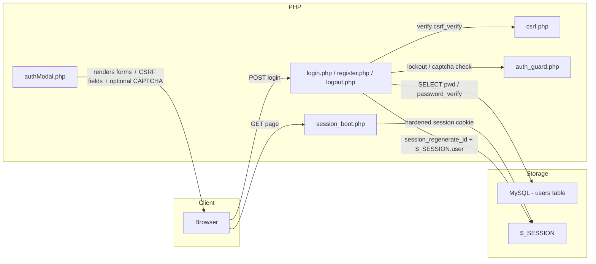
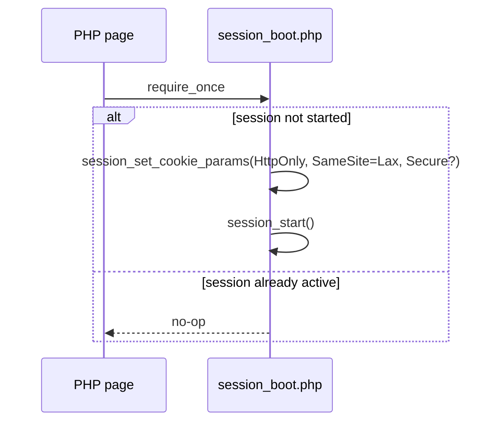
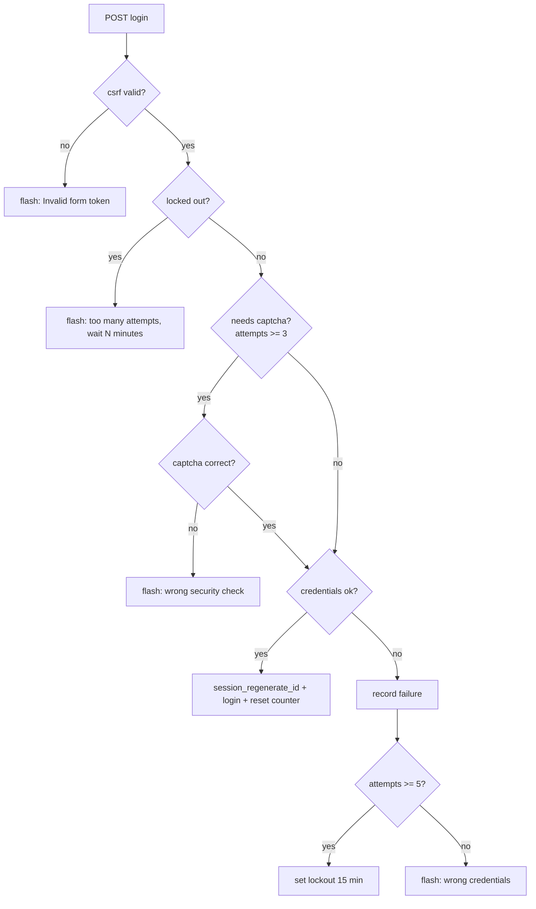

# MythiFox — Authentication Security

This document describes the security layer added to the login, sign-up, and session handling of MythiFox. It complements `feat/login-modal` (the animated modal UI) with the server-side protections described here.

## Overview

The authentication flow previously accepted weak passwords, had no protection against brute-force login attempts, was vulnerable to CSRF, and did not rotate session IDs after login. The following countermeasures are now in place:

| Threat | Countermeasure | Where |
|---|---|---|
| Weak passwords | Sign-up policy: ≥ 8 chars, at least one letter and one number | `register.php` |
| Brute-force login | Failed-attempt tracking → math CAPTCHA after 3 fails → 15-minute lockout after 5 fails | `auth_guard.php` |
| Cross-site request forgery | CSRF token on login, sign-up and logout forms | `csrf.php` |
| Session fixation | `session_regenerate_id(true)` on login and sign-up | `login.php`, `register.php` |
| Cookie exfiltration / hijacking | `HttpOnly` + `SameSite=Lax` + `Secure` (when HTTPS) session cookies | `session_boot.php` |
| Session ID guessing | PHP strict session mode | `session_boot.php` |

## Architecture



## Session bootstrap (`session_boot.php`)

All entry points start their session through this single include instead of calling `session_start()` directly. Before starting the session it:

1. Sets cookie flags — `HttpOnly`, `SameSite=Lax`, and `Secure` when the request is HTTPS.
2. Keeps the session cookie lifetime at `0` (browser session).

The include is idempotent: if a session already exists, it does nothing, so `header.php`, `sidebar.php`, and `authModal.php` can safely require it even when the page already booted the session.



## CSRF protection (`csrf.php`)

- `csrf_token()` — lazy-generates a 32-byte random token and stores it in the session.
- `csrf_field()` — returns the hidden `<input name="csrf">` used by every auth form.
- `csrf_verify()` — constant-time comparison (`hash_equals`) of the submitted token against the session token.

The token is rendered in `authModal.php` for both forms and in `header.php` for the logout form. `login.php`, `register.php`, and `logout.php` reject the request immediately if the token is missing or invalid, before any other processing.

## Brute-force protection (`auth_guard.php`)

Failed login attempts are tracked in `$_SESSION['auth']`:



- The CAPTCHA is a simple arithmetic question ("what is 3 + 5?") generated locally with `random_int` — no external service or API keys, so it works offline on XAMPP.
- After 5 failed attempts the account (per browser session) is locked for 15 minutes; the remaining wait is shown in seconds→minutes.
- A successful login or sign-up resets the counter.

## Password policy

Sign-up (`register.php`) now enforces:

- Username: `^[A-Za-z0-9_]{3,20}$`
- Password: minimum 8 characters, containing at least one letter `[A-Za-z]` and one digit `[0-9]`

Failures return a human-friendly flash message rendered inline in the modal (no `alert()`). Passwords continue to be stored with `password_hash()` / verified with `password_verify()`.

## Login hardening

The login handler previously answered with two different messages — "Username not found" versus
"Incorrect password" — which let anyone enumerate valid accounts, and it only compared a real hash
when the account existed, so response time also leaked account existence.

Both signals are removed:

- A single generic message, `Invalid username or password. Try again.`, covers every failure.
- When no account matches, `password_verify()` is still run against a fixed dummy bcrypt hash so the
  work factor is the same in both branches.
- The query now selects `id, pwd` and stores `$_SESSION['user_id']` alongside `$_SESSION['user']`, so
  ownership checks can use a stable identifier instead of a mutable username string.
- POST values are read through a string-only accessor, so array-shaped input cannot reach the query.

## Session identity

`include/account.php` owns the mapping between a session and an account:

- `account_current_user_id()` trusts `$_SESSION['user_id']` when present, and otherwise resolves the
  legacy `$_SESSION['user']` username to an id and backfills it. Sessions created before this change
  keep working.
- `account_user_by_id()` and `account_user_by_username()` return a single normalised row shape, so
  callers never read undefined array keys.

Every mutating endpoint (`include/edit_profile.php`, `include/update_post.php`,
`include/delete_post.php`) resolves ownership through this helper and scopes its `UPDATE`/`DELETE` with
`WHERE user_id = ?`, so an authorisation check and the write cannot drift apart.

## CSRF coverage

`SameSite=Lax` session cookies already block ordinary cross-site form posts in modern browsers, but they
do not protect a state change triggered by a top-level `GET` navigation, and they are not a substitute
for an explicit token. Every mutating endpoint now verifies a token itself and rejects anything other
than `POST`.

| Endpoint | Method guard | CSRF | Ownership |
|---|---|---|---|
| `authentication/login.php` | POST only | Yes | n/a |
| `authentication/register.php` | POST only | Yes | n/a |
| `authentication/logout.php` | POST only | Yes | Session |
| `authentication/resend_verification.php` | POST only | Yes | Session |
| `include/edit_profile.php` | POST only | Yes | `user_id` |
| `include/makePost.php` | POST only (renders on GET) | Yes | Session |
| `include/update_post.php` | 405 otherwise | Yes | `post.user_id` |
| `include/delete_post.php` | 405 otherwise | Yes | `post.user_id` |
| `include/like_post.php` | 405 otherwise | Yes (form field or `X-CSRF-Token`) | Session |

The token is published to the page in a `<meta name="csrf-token">` element so the asynchronous like
button can send it in both a form field and a request header.

## Logout

`logout.php` now requires a CSRF-valid POST, clears the session array, expires the session cookie client-side, and then destroys the server-side session.

## Email foundation and verification

The provider-independent mail layer is documented in [`email-system.md`](email-system.md). It uses PHPMailer behind `MailerInterface` and a local Mailpit SMTP inbox during development.

Account registration now stores a normalized email address and sends a verification link through the mailer. Verification tokens are stored only as SHA-256 hashes, expire after 24 hours, and are consumed in a transaction. The current login policy is unchanged, so unverified accounts can still sign in; future email-dependent actions can require `email_verified_at`.

The verification and resend lifecycle is documented in [`email-verification.md`](email-verification.md). Changing the email of an existing account uses a separate pending-address flow documented in [`email-change.md`](email-change.md).

## Profile and post editing

The profile editor, the shared username and bio policy, and the avatar crop flow are documented in
[`profile-editing.md`](profile-editing.md). The redesigned profile page is documented in
[`profile-page.md`](profile-page.md).

## Upload hardening

`include/upload_helper.php` no longer trusts the client-supplied extension or size:

- `getimagesize()` must succeed and the detected MIME type must be in the allow-list.
- The detected MIME must match the declared extension, so a `.png` that is really a script is rejected.
- Dimensions must be positive and within the 6000 px ceiling.
- The stored extension is derived from the detected MIME, not from the filename.
- Stored names are random (`profile_<32 hex>.<ext>`), replacing the previous `time()`-based naming.
- Post upload directories are created with `0755` instead of `0777`.
- Replacing or removing an avatar deletes the previous file, so uploads no longer accumulate.

## Files

| File | Role |
|---|---|
| `include/session_boot.php` | Hardened session start |
| `include/csrf.php` | CSRF token helpers |
| `include/auth_guard.php` | Attempt counter, lockout, math CAPTCHA |
| `include/account.php` | Session → account identity resolution and row access |
| `include/profile_validation.php` | Shared username, bio, and POST input rules |
| `authentication/login.php` | Login handler with CSRF, generic errors, lockout, session rotation |
| `authentication/register.php` | Sign-up handler with CSRF, shared password/username policy, email verification issue |
| `authentication/resend_verification.php` | CSRF-protected generic verification resend endpoint |
| `authentication/verify_email.php` | Single-use verification-token consumer |
| `authentication/verify_email_change.php` | Single-use email-change token consumer and status page |
| `include/email_verification.php` | Token lifecycle and email-verification service |
| `include/email_change.php` | Pending-address issue and transactional consume |
| `include/email_templates/verification.php` | Escaped verification email template |
| `include/email_templates/email_change.php` | Escaped email-change confirmation template |
| `include/edit_profile.php` | POST-only, CSRF-protected profile update handler |
| `include/upload_helper.php` | Image validation and extension derivation |
| `include/post_actions.php` | Shared owner-only post edit and delete controls |
| `authentication/logout.php` | CSRF-protected logout |
| `include/authModal.php` | Modal markup: CSRF fields, CAPTCHA field, password hint |
| `include/header.php` | Logout form now carries a CSRF field |

## Tests

Run from the project root with the XAMPP PHP binary:

```
php tests\profile_validation_test.php
php tests\email_change_test.php
php tests\email_change_roundtrip_test.php
php tests\email_verification_test.php
php tests\post_actions_test.php
php tests\mailer_smoke_test.php    (requires a running Mailpit)
```