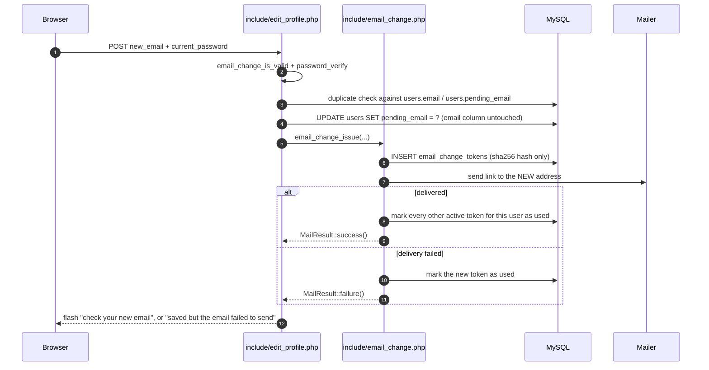
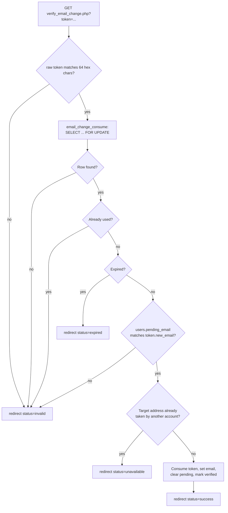

# MythiFox — Email Change Verification

This document describes the pending-email flow that backs the email field of the profile editor.
Unlike initial sign-up verification, a profile email change never replaces the active address
directly: the new address is stored as `pending_email` and only becomes the account email after the
owner clicks a single-use link sent to that new address.

It builds on the token primitives documented in
[`email-verification.md`](./email-verification.md) and is triggered from
[`profile-editing.md`](./profile-editing.md).

## Why a pending address

Activating an email immediately would let anyone who can write to the form take over the account's
recovery channel, and would make an accidental typo unrecoverable without password reset. Deferring
the swap keeps two properties at once:

- The current address stays usable for the whole confirmation window.
- Control of the new address must be proven before it becomes the account identity.

## Schema

Migration [`database/migrations/005_profile_email_changes.sql`](../database/migrations/005_profile_email_changes.sql):

```sql
ALTER TABLE users
    ADD COLUMN pending_email VARCHAR(254) NULL DEFAULT NULL,
    ADD UNIQUE KEY uq_users_pending_email (pending_email);

CREATE TABLE email_change_tokens (
    id BIGINT UNSIGNED NOT NULL AUTO_INCREMENT,
    user_id INT(11) NOT NULL,
    new_email VARCHAR(254) NOT NULL,
    token_hash CHAR(64) NOT NULL,
    expires_at DATETIME NOT NULL,
    created_at TIMESTAMP NOT NULL DEFAULT CURRENT_TIMESTAMP,
    used_at DATETIME NULL DEFAULT NULL,
    PRIMARY KEY (id),
    UNIQUE KEY uq_email_change_tokens_hash (token_hash),
    KEY idx_email_change_tokens_user (user_id),
    KEY idx_email_change_tokens_expiry (expires_at),
    CONSTRAINT fk_email_change_tokens_user
        FOREIGN KEY (user_id) REFERENCES users (id) ON DELETE CASCADE
);
```

`uq_users_pending_email` makes two accounts racing for the same new address fail at the database level
rather than in application code. Multiple `NULL` values are permitted, so accounts without a pending
change are unaffected.

## Issue



The raw token exists only in the message body. The database stores `sha256(raw)`, so a database dump
does not yield usable confirmation links.

Invalidating the previous tokens only *after* a successful send means a transport outage does not
destroy a link that was already delivered. A failed send consumes only the token that never arrived.

## Consume

`authentication/verify_email_change.php` handles both the token request and the resulting status page.



Every rejection rolls the transaction back, so a failed attempt leaves the token usable until it
genuinely expires or is superseded.

The `SELECT ... FOR UPDATE` lock plus the `WHERE pending_email = ?` guard on the final `UPDATE` make
the flow safe under concurrent clicks: only the first request can match a given pending value, and the
second one finds `affected_rows = 0` and rolls back.

## Response handling

- `Cache-Control: no-store` and `Referrer-Policy: no-referrer` are sent so the token-bearing URL is
  never cached or leaked through the `Referer` header.
- The token is consumed on a `303` redirect to a token-free status page, which keeps the secret out
  of browser history entries after the first hop.
- A used token reports `invalid`, exactly like an unknown or malformed one, so the response does not
  reveal whether a token ever existed.

## Status codes

| Status | Meaning shown to the user |
|---|---|
| `success` | The new address is now active. |
| `expired` | The link aged out; request a new one from the profile. |
| `unavailable` | The address was claimed by another account in the meantime. |
| `invalid` | Unknown, malformed, already used, or superseded link. |
| `error` | The request could not be processed; ask for a new link. |

## Testing

- `tests/email_change_test.php` — normalisation, address validation, template escaping, rejection of
  malformed and unknown tokens, and that the stored value is a SHA-256 hash.
- `tests/email_change_roundtrip_test.php` — full lifecycle against a real database: issue, capture the
  raw token from the delivered message, confirm that plaintext is never persisted, consume it, assert
  that `email` becomes active while `pending_email` clears and `email_verified_at` is set, assert that
  replaying the same token fails, and assert that a reissued token is accepted.

Both tests create and remove their own user rows, so they can be run repeatedly against a development
database without leaving residue.

Manual checklist:

- [ ] A new address stays pending and the current address keeps working until confirmation.
- [ ] The confirmation link activates the address exactly once.
- [ ] The profile shows an "Email change pending" state while unconfirmed.
- [ ] Requesting an address already used by another account is refused.
- [ ] A failed mail send leaves the profile saved and explains that the email must be retried.
