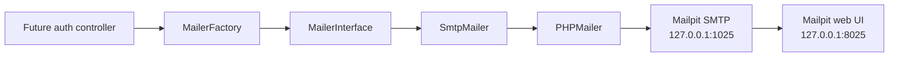
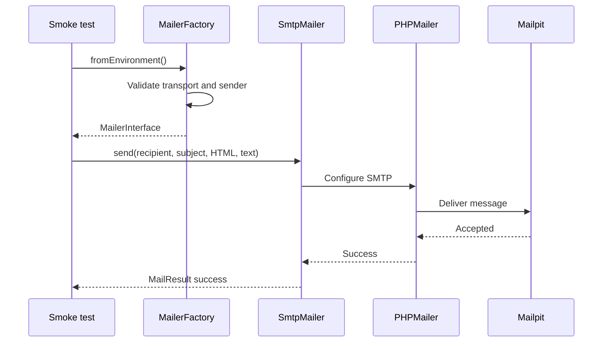

# MythiFox — Email System

Status: mail transport foundation implemented; account verification and password-reset flows are not yet connected.

## Purpose

MythiFox sends transactional email through a small application boundary backed by PHPMailer. During local development, SMTP delivery targets Mailpit so messages remain on the computer and are visible at `http://127.0.0.1:8025` instead of being sent to real recipients.

## Architecture



The future authentication controller will depend on `MailerInterface`, not PHPMailer. This keeps verification and password-reset code independent from the SMTP provider and allows another transport to be introduced without rewriting those flows.

## Component responsibilities

| Component | Responsibility |
|---|---|
| `composer.json` | Declares PHPMailer and the PHP version |
| `composer.lock` | Pins the exact dependency version |
| `include/mailer/MailerInterface.php` | Provider-independent send contract |
| `include/mailer/MailResult.php` | Safe success or failure result |
| `include/mailer/mail_config.php` | Reads mail settings from environment variables |
| `include/mailer/MailerFactory.php` | Validates configuration and creates the SMTP adapter |
| `include/mailer/SmtpMailer.php` | Configures PHPMailer and performs delivery |
| `tests/mailer_smoke_test.php` | Sends one local test message |

## Local SMTP configuration

Mailpit listens on SMTP port `1025` and its web interface on port `8025` by default. MythiFox uses the following environment variables:

| Variable | Local default | Purpose |
|---|---|---|
| `MAIL_TRANSPORT` | `smtp` | Selects the transport |
| `MAIL_HOST` | `127.0.0.1` | SMTP host |
| `MAIL_PORT` | `1025` | SMTP port |
| `MAIL_ENCRYPTION` | empty | Use `tls` or `ssl` for secured SMTP |
| `MAIL_USERNAME` | empty | SMTP username |
| `MAIL_PASSWORD` | empty | SMTP password |
| `MAIL_FROM_ADDRESS` | `no-reply@mythifox.local` | Sender address |
| `MAIL_FROM_NAME` | `MythiFox` | Sender display name |
| `MAIL_TIMEOUT` | `10` | SMTP timeout in seconds |
| `APP_URL` | `http://localhost/MythiFox` | Base URL for future email links |

Secrets are supplied through the PHP or Apache process environment. They are not stored in source code.

## Start Mailpit

Run Mailpit with its listeners restricted to the local machine:

```powershell
mailpit --listen 127.0.0.1:8025 --smtp 127.0.0.1:1025
```

Open `http://127.0.0.1:8025` to inspect captured messages.

## Install Composer dependencies

The repository tracks `composer.json` and `composer.lock` but ignores `vendor/`. With PHP available on `PATH`, install the locked dependency with:

```powershell
composer install --prefer-source
```

`--prefer-source` is required for the current XAMPP PHP installation because it does not provide the ZIP extension or an unzip utility. Environments with `ext-zip` can use plain `composer install`.

For this Windows XAMPP installation, Composer is available through:

```powershell
composer install
```

The local Composer launcher uses `C:\xampp\php\php.exe` and the verified Composer PHAR installed under the current user's local application data.

## Send the smoke-test message

With Mailpit running:

```powershell
& 'C:\xampp\php\php.exe' tests\mailer_smoke_test.php
```

The command reports success only after SMTP accepts the message:

```text
Mail delivered to test@mythifox.local
```

Set `MAIL_TEST_RECIPIENT` to test a different recipient:

```powershell
$env:MAIL_TEST_RECIPIENT = 'another-address@example.test'
& 'C:\xampp\php\php.exe' tests\mailer_smoke_test.php
```

## Delivery behavior



Invalid recipients return `invalid_recipient`. SMTP failures return `smtp_delivery_failed`; the browser-facing application layer can therefore show a generic message without exposing server details. Operational failures are logged by exception class or a fixed event name, not by message body or reset token.

## Current verification

The foundation was verified on 2026-09-25:

- [x] `composer validate --strict` succeeds.
- [x] `composer audit` reports no known dependency advisories.
- [x] All mailer PHP files pass syntax checks.
- [x] The smoke test returns success while Mailpit is running.
- [x] Mailpit displays both the HTML and plain-text message.
- [x] The smoke test returns `smtp_delivery_failed` when Mailpit is unavailable.
- [x] `vendor/` remains ignored and untracked.

## Next integration steps

1. Add account email fields and migrations.
2. Create a password-policy helper shared by registration and reset.
3. Add purpose-bound verification and reset token tables.
4. Send verification and reset messages through `MailerInterface`.
5. Add rate limits and generic user-facing responses.
6. Test the complete authentication flows in XAMPP.
