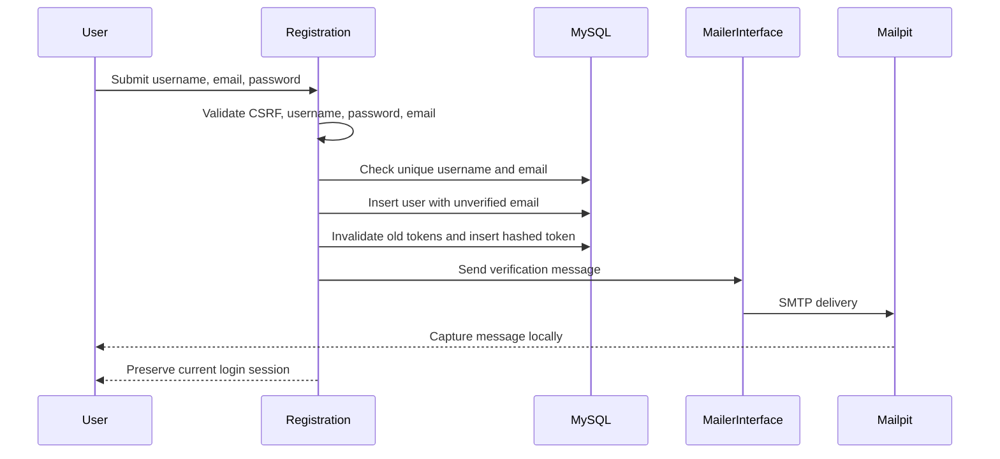
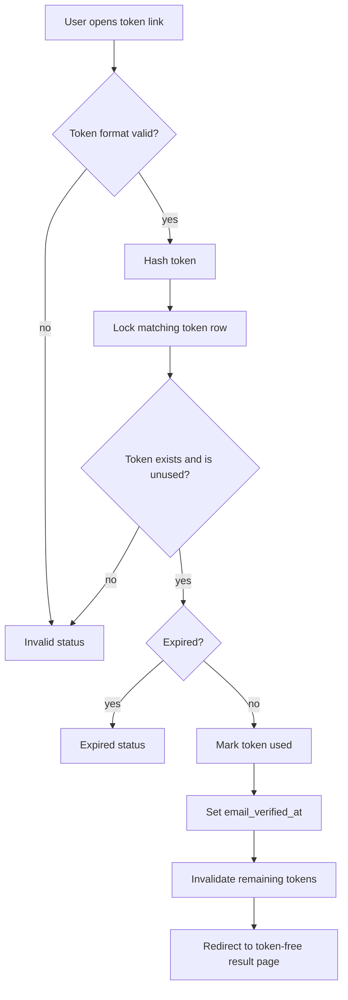

# MythiFox — Email Verification

Status: local account-email and verification flow implemented; password reset is not implemented.

## Purpose

New MythiFox accounts collect an email address and receive a one-time verification link through the provider-independent mailer. Local development uses Mailpit, so the complete flow can be tested without a purchased domain or a real mailbox.

## Account storage

Migration `database/migrations/003_user_emails.sql` adds nullable fields to `users`:

| Column | Meaning |
|---|---|
| `email` | Normalized account email, unique when present |
| `email_verified_at` | Verification completion time, or `NULL` |

Existing accounts keep `NULL` email values and continue to use the current login behavior. New registrations require an email and begin with `email_verified_at = NULL`.

Email input is trimmed and converted to lowercase before validation and uniqueness checks. The database uses the existing case-insensitive table collation for the unique index.

## Token storage

Migration `database/migrations/004_email_verification_tokens.sql` creates `email_verification_tokens`:

| Column | Meaning |
|---|---|
| `user_id` | Account that requested verification |
| `token_hash` | SHA-256 hash of the raw token |
| `expires_at` | Expiration time |
| `created_at` | Creation time |
| `used_at` | Consumption time, or `NULL` |

The raw token exists only in the verification URL sent to the user. It is never stored in the database or written to application logs.

## Registration flow



If mail delivery fails, the account remains available and the user receives a generic notice. The resend page can issue a new token later. The current login policy is intentionally unchanged: unverified users may still sign in, while email-dependent actions can enforce verification later.

## Verification flow



The verification route is `authentication/verify_email.php`. It accepts a token only for the initial request, processes it in a transaction, and redirects to a status page without the token in the final URL.

The result page uses `Cache-Control: no-store` and `Referrer-Policy: no-referrer`.

## Resend flow

`authentication/resend_verification.php` accepts an email address and CSRF token.

- Valid and unknown addresses receive the same response.
- Verified accounts do not receive a new token.
- Unverified accounts are limited to one new token every 60 seconds per account.
- A new request invalidates the account's earlier unused tokens.
- SMTP and token errors are not shown as provider details.

The cooldown is persisted in the token table rather than only in the browser session.

## Local configuration

No domain is required for local development. The defaults remain:

```text
MAIL_HOST=127.0.0.1
MAIL_PORT=1025
MAIL_FROM_ADDRESS=no-reply@mythifox.local
APP_URL=http://localhost/MythiFox
```

Start Mailpit, run the application through XAMPP, register with an address such as `student@example.test`, and open `http://127.0.0.1:8025` to read the message. The link uses the configured `APP_URL`.

## Production configuration

Before public deployment, configure the real SMTP host, authentication, sender address, and HTTPS `APP_URL` through the hosting environment. The application code remains transport-independent, but the sending domain must be authorized by the chosen provider.

The production deployment should also verify SPF, DKIM, and DMARC records and decide whether a separate `Reply-To` address is required.

## Security properties

- Tokens are generated with `random_bytes()`.
- Only SHA-256 token hashes are stored.
- Tokens expire after 24 hours.
- Tokens are single-use and consumed transactionally.
- Dynamic HTML values are escaped in the template.
- Verification and resend responses do not disclose SMTP details.
- The raw token is not included in application error logs.
- CSRF protection is required for resend requests.

## Testing checklist

- [x] Migrations apply to the local MariaDB database.
- [x] Invalid registration email is rejected.
- [x] Email addresses are trimmed and lowercased.
- [x] Duplicate email addresses are rejected.
- [x] Mailpit receives a verification message.
- [x] A valid token marks the account verified.
- [x] A consumed token cannot be reused.
- [x] An invalid token is handled without echoing the token.
- [ ] Production SMTP provider and DNS verification
- [ ] Password reset flow
