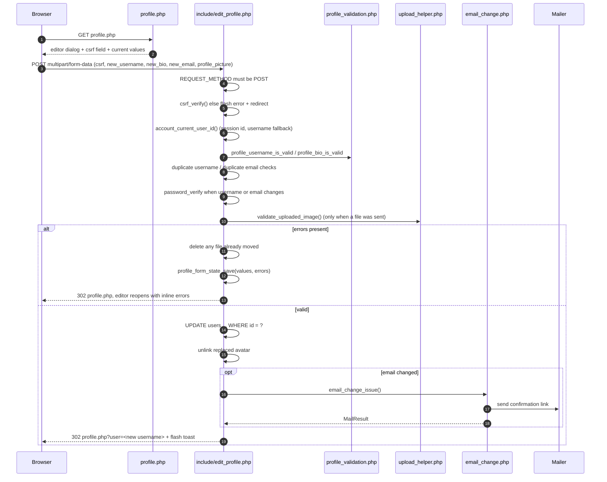
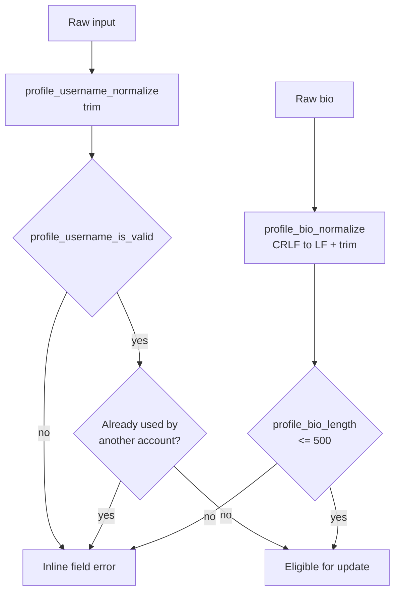

# MythiFox — Profile Editing

This document describes the profile editing subsystem: the shared validation rules, the secured
`include/edit_profile.php` endpoint, avatar handling with client-side crop/resize, and the inline
error plus toast feedback loop.

It complements [`auth-security.md`](./auth-security.md) (session and CSRF foundations) and
[`email-change.md`](./email-change.md) (the deferred email activation flow triggered from this form).

## Scope

| Field | Editable | Validation | Extra rule |
|---|---|---|---|
| Username | Yes | `/\A[A-Za-z0-9_]{3,20}\z/` | Must be unique; current password required |
| Bio | Yes | Trimmed, CRLF normalised, max 500 characters | — |
| Profile picture | Yes | Re-encoded image, 5 MB, max 6000×6000, max dimension enforced | Current password not required |
| Email | Yes | RFC-shaped, normalised to lowercase, max 254 | Current password required; activated only after confirmation |

Deleting the profile picture is supported through the same form (`remove_profile_pic=1`) and resets
the avatar to `assets/default.jpg`.

## Request flow

## Security properties

- **POST only.** Any other verb is redirected to `profile.php` without touching state. The previous
  implementation mutated the account from a plain `GET`, which a third-party site could trigger with
  an `` tag.
- **CSRF enforced.** `csrf_verify()` runs before any field is read, so a cross-site submission cannot
  change an account.
- **Ownership by user id.** All reads and writes resolve the account through
  `account_current_user_id()`, so a stale or tampered `$_SESSION['user']` string cannot retarget the
  update.
- **Password reconfirmation.** Changing the username or the email address requires the current
  password, so a hijacked session alone cannot take over the identity of an account.
- **Atomic failure.** A new avatar is only written after every other validation passes; if the
  `UPDATE` fails the freshly moved file is deleted, and if a validation fails after the move the file
  is removed again. The database row and the filesystem never disagree.
- **Orphan cleanup.** Replacing or removing an avatar deletes the previous file only when it lives
  under `uploads/profile_pics/`, so shared asset paths are never unlinked.

## Shared validation

`include/profile_validation.php` is the single source of truth for the username and bio rules.
`authentication/register.php` and `include/edit_profile.php` both call it, which removes the previous
drift where sign-up enforced a policy that profile editing ignored.

`profile_request_string()` is the input accessor for every POST value. It returns `''` for anything
that is not a string, so array-shaped input such as `new_username[]=x` can never reach a prepared
statement as an array.

## Feedback model

The endpoint never renders HTML. It stores either a `profile_form` state (field-keyed errors plus the
submitted values) or a `profile_flash` (one-shot toast) in the session, then redirects. `profile.php`
consumes and clears that state on the next request, so a refresh never re-submits and never shows a
stale error.

- Field errors are rendered next to their input with `role="alert"`.
- Success, and the "saved but the confirmation email could not be sent" case, use the toast channel.
- The editor dialog only auto-opens when the incoming state contains errors.

## Avatar crop and resize

`assets/profile.js` implements the crop step with no third-party dependency:

1. The chosen file is validated in the browser (MIME allow-list, 5 MB ceiling) before any decoding.
2. The image is decoded into an `Image` and drawn to a square `320×320` canvas using a cover fit
   (`max(size/w, size/h)`), so the result is already centred and cropped.
3. A zoom slider from `1×` to `3×` redraws the canvas around the centre point.
4. "Use this crop" converts the canvas to a PNG `File` and swaps it into the existing file input via
   `DataTransfer`, so the form still posts through the normal `multipart/form-data` submit.
5. Submitting while the crop panel is open is blocked with a toast, which prevents silently uploading
   the uncropped original.

Server-side, `validate_uploaded_image()` re-derives the extension from the detected MIME type instead
of trusting the client filename, so a `.png` that is really a PHP script is rejected, and stored names
are `profile_<32 hex chars>.<ext>` rather than `time()`-based guesses.

## Testing

`tests/profile_validation_test.php` covers the username and bio rules, including the exact 500
character boundary, CRLF normalisation, and array-injection rejection through
`profile_request_string()`.

`tests/post_actions_test.php` covers the shared post control partial, including that non-owners and
anonymous visitors receive no markup at all.

Behaviour that depends on a real upload is verified by the `validate_uploaded_image()` unit surface
plus the manual checklist below.

Manual checklist:

- [ ] Submitting the editor without a CSRF token changes nothing.
- [ ] Sending a `GET` to `include/edit_profile.php` changes nothing.
- [ ] Changing the username or email without the current password is refused.
- [ ] A 501 character bio is refused; 500 characters is accepted.
- [ ] A renamed account lands on `profile.php?user=<new name>` and the header reflects the new name.
- [ ] Replacing an avatar removes the previous file from `uploads/profile_pics/`.
- [ ] Removing the avatar restores `assets/default.jpg`.
- [ ] A file that is not a real image is rejected and leaves the previous avatar in place.
