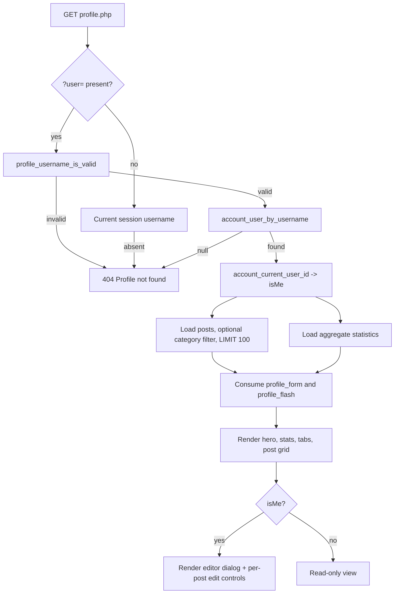
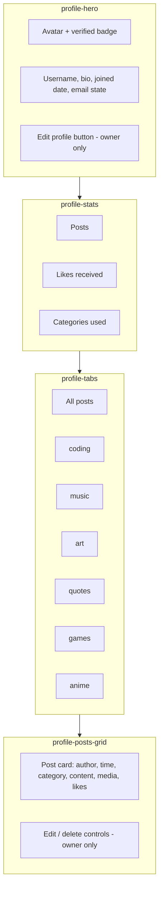

# MythiFox — Profile Page

This document describes the redesigned public profile page (`profile.php`): its data model, layout,
filtering, statistics, and how it embeds the profile editor and the shared post controls.

The editor itself is documented in [`profile-editing.md`](./profile-editing.md).

## Responsibilities

`profile.php` is a read-mostly page with one write path:

All displayed values are escaped with `ENT_QUOTES | ENT_SUBSTITUTE`. Usernames are constrained to the
`[A-Za-z0-9_]{3,20}` policy before they are used, so an unknown or malformed `?user=` value produces a
plain `404` rather than a query or a rendered error.

## Layout

- **Hero** carries the identity, the optional bio, the join date, and an at-a-glance email state
  (`verified`, `not verified`, `change pending`, or `no email on file`). The raw address is never shown
  publicly.
- **Statistics** come from a single aggregate query, not from counting the rendered page, so filtering
  by category does not change the numbers.
- **Tabs** are ordinary links to `profile.php?user=<name>&category=<slug>`. An unrecognised `category`
  value is ignored and the "All posts" view is shown, so no query is ever built from raw input.
- **Post cards** reuse `include/post_actions.php`, which is the same partial the feed uses. That is why
  the broken duplicate-ID editor that used to live on this page is gone: there is no per-post editor
  markup in `profile.php` any more.

## Performance

- Posts are fetched with a bounded `LIMIT 100` and ordered by `created_at DESC`, indexed through
  `posts.user_id`.
- Statistics use one `COUNT` / `SUM` / `COUNT(DISTINCT)` query rather than one query per card.
- The page issues a single connection, closes it before rendering, and prepares every statement.
- The category filter is a server-side `WHERE` clause with a bound parameter, not client-side hiding.

## Responsive behaviour

The page collapses from a three-column desktop arrangement to a single centred column at 720 px, and
drops the persistent left navigation margin at 1100 px. The editor switches from a side-by-side
avatar row to a stacked layout, and the statistics grid moves from three columns to one.

## Empty and error states

- No posts in the selected view renders a dashed "No posts here yet" panel, with owner-specific copy.
- An unknown or malformed username returns HTTP `404` with a minimal body and no database detail.
- A failed posts or statistics query returns HTTP `500` with a short message rather than a partially
  rendered page.

## Testing

Rendering is verified through the integration checklist in
[`profile-editing.md`](./profile-editing.md) plus these manual checks:

- [ ] `profile.php?user=<valid>` renders hero, statistics, tabs, and the post grid.
- [ ] `profile.php?user=<unknown>` returns `404`.
- [ ] `profile.php?user=<invalid characters>` returns `404`.
- [ ] `profile.php?category=<valid>` filters posts and statistics stay unchanged.
- [ ] `profile.php?category=<garbage>` falls back to all posts.
- [ ] A signed-in owner sees the editor and the per-post edit and delete controls.
- [ ] A signed-in visitor sees neither.
- [ ] An anonymous visitor sees the read-only page.
