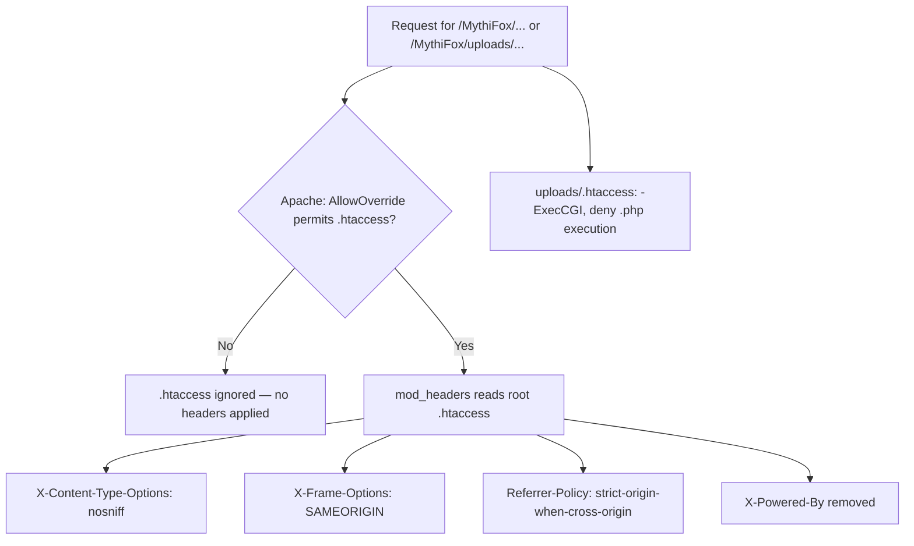

# MythiFox — HTTP Security Headers

This document describes the site-wide response security headers configured in the root `.htaccess`. The change is deliberately standalone: it is cut from `main` on its own branch (`chore/security-headers`) so it can be reviewed, merged, or reverted without touching feature work.

## Overview

MythiFox serves user-supplied content (profile pictures, post images) and handles single-use email-change confirmation links. Every response previously went out with Apache/PHP defaults, which leaks the technology stack and leaves browsers free to mis-handle content types, framing, and referrers.

| Header | Value | Threat addressed |
|---|---|---|
| `X-Content-Type-Options` | `nosniff` | MIME sniffing turning an uploaded file into executable content |
| `X-Frame-Options` | `SAMEORIGIN` | Clickjacking via framing MythiFox in a hostile page |
| `Referrer-Policy` | `strict-origin-when-cross-origin` | Leaking full URLs (which carry single-use tokens) to third parties |
| `X-Powered-By` | *(unset)* | Disclosing the exact PHP version to scanners |

## Architecture

Apache applies the file to every request that passes through the document root. The root `.htaccess` sets response headers; the pre-existing `uploads/.htaccess` sets execution permissions. They are independent and complementary.



## Why these headers matter here

### `X-Content-Type-Options: nosniff`

`include/upload_helper.php` determines the real image type with `getimagesize()` (not the client-supplied `Content-Type`) and rejects any upload whose filename extension does not match the detected type. `uploads/.htaccess` then denies execution of any remaining PHP-like file. `nosniff` is the third layer: it stops a browser from ignoring a stored `Content-Type` and re-interpreting, say, an uploaded image as script.

### `X-Frame-Options: SAMEORIGIN`

The app has no legitimate need to be framed by another origin. `SAMEORIGIN` keeps the site usable inside its own layout while blocking external framing, which is the delivery mechanism for clickjacking against the like button and the account actions.

`SAMEORIGIN` rather than `DENY` is chosen so that a stricter future policy (a real `Content-Security-Policy` with `frame-ancestors 'none'`) can be introduced without having to relax an existing `DENY`, while still blocking every cross-origin framing attempt today.

### `Referrer-Policy: strict-origin-when-cross-origin`

This is the header most directly tied to a MythiFox feature. The email-change confirmation link looks like:

```text
http://localhost/MythiFox/authentication/verify_email_change.php?token=<single-use token>
```

If a user clicks that link and then follows a link to an external site, the default browser behaviour (`strict-origin-when-cross-origin` on modern browsers, but `no-referrer-when-downgrade` or full-URL leaking on older ones) could put the token in the `Referer` header of the outbound request. `strict-origin-when-cross-origin` guarantees that cross-origin requests carry **only the origin** — `http://localhost/MythiFox` — never the path or query string.

Note that the policy governs browser-generated `Referer` headers only. It cannot stop a user from manually copying the confirmation URL into a chat or a public paste, which is why the token is single-use, short-lived, and tied to a pending-email row.

### `X-Powered-By` unset

Apache/XAMPP ships with `ServerTokens` and `ServerSignature` handled by the server config; those directives are invalid inside `.htaccess` and are intentionally excluded here. Removing the PHP version header is the part that *is* achievable per-directory, and it removes a free input for automated vulnerability scanners.

This header needs the **non-`always`** form (`Header unset X-Powered-By`), which is the one asymmetric detail in the file. The two directives act on separate tables:

| Directive | Applies to |
|---|---|
| `Header always unset X` | Error responses only (`ap_send_error_response`) |
| `Header unset X` | Successful / normal responses (`ap_hook_headers`) |

PHP's SAPI injects `X-Powered-By` into the normal header table *during response finalization*, so it never appears in the `always` table. `Header always unset X-Powered-By` therefore silently does nothing, while `Header unset X-Powered-By` works. Verified: the `always` variant was tested first and left `X-Powered-By: PHP/8.2.12` in the response.

For a belt-and-braces result on a real deployment, also set `expose_php = Off` in `php.ini` — that is a server-level change and is deliberately not part of a repo-committed file.

## Scope and layering

`Header always set` is used for the three security headers instead of `Header set` because PHP pages are served through `mod_php`/`mod_proxy_fcgi` and are therefore subject to internal redirects. The `always` variant applies to responses generated by Apache *and* those produced by modules later in the pipeline, so the headers survive a PHP-handled error page (403 from `uploads/`, 404 from a PHP script, 500 from an uncaught exception). This was confirmed empirically — the `403` response for `/MythiFox/uploads/` carries all three headers.

`X-Powered-By` is the deliberate exception and uses plain `Header unset`; the reasoning is in its own section below.

The `<IfModule mod_headers.c>` wrapper means that if the module is unavailable, Apache skips the block rather than failing the whole request with a 500.

```mermaid
sequenceDiagram
    participant B as Browser
    participant A as Apache (mod_php)
    participant P as index.php / posts.php / profile.php
    B->>A: GET /MythiFox/profile.php
    A->>P: dispatch after merging .htaccess
    P-->>A: 200 OK + HTML
    A->>A: mod_headers applies always-set + unset directives
    A-->>B: 200 OK with nosniff, SAMEORIGIN, referrer-policy; no X-Powered-By
```

## Deliberately excluded

| Candidate | Why not |
|---|---|
| `ServerTokens Prod`, `ServerSignature Off` | `ServerTokens` is `httpd.conf`-only and is rejected as invalid inside `.htaccess` |
| `Strict-Transport-Security` | The project runs over plain HTTP on `localhost`; an HSTS header would be ignored but would lock a future HTTPS deployment into a policy it may not want. Add it at the HTTPS termination point |
| `Content-Security-Policy` | Requires an explicit allow-list. All JavaScript is already external (`assets/script.js`), but the pages still carry 9 inline `style="..."` attributes and one inline `onsubmit` handler (`index.php:102`), so a policy would need `'unsafe-inline'` in `style-src` — i.e. it would buy `script-src` protection while leaving style injection open. Deferred until those are extracted; note the strictest useful form would be `script-src 'self'; object-src 'none'; base-uri 'self'` |
| `Permissions-Policy` | No camera, microphone, geolocation, or payment features to lock down yet; the header can be added with a restrictive default when such features appear |

## Prerequisites

`.htaccess` is only honoured when the Apache virtual host allows overrides. In the XAMPP default configuration this is:

```apache
<Directory "C:/xampp/htdocs">
    AllowOverride All
    ...
</Directory>
```

If `AllowOverride` is `None`, the file is silently ignored and no headers appear. Because the failure mode is silent, always verify the actual response rather than assuming the file was applied — see the verification recipe below.

Confirmed present in `C:\xampp\apache\conf\httpd.conf`:

| Setting | Line | Value |
|---|---|---|
| `DocumentRoot` | 252 | `C:/xampp/htdocs` |
| `AllowOverride` (htdocs block) | 273 | `All` |
| `LoadModule headers_module` | 120 | enabled |

## Verification

Start Apache (XAMPP Control Panel, or `C:\xampp\apache\bin\httpd.exe`), then inspect the real response:

```powershell
curl.exe -s -D - -o NUL http://localhost/MythiFox/index.php
```

Observed result:

```text
HTTP/1.1 200 OK
Server: Apache/2.4.58 (Win64) OpenSSL/3.1.3 PHP/8.2.12
X-Content-Type-Options: nosniff
X-Frame-Options: SAMEORIGIN
Referrer-Policy: strict-origin-when-cross-origin
Set-Cookie: PHPSESSID=...; path=/; HttpOnly; SameSite=Lax
Content-Type: text/html; charset=UTF-8
```

Note what is *absent*: no `X-Powered-By:` line, and no `Server:` reduction (`ServerTokens Prod` cannot be set from `.htaccess`).

The error-path check confirms both that the sibling hardening still applies and that the `always` variant reaches non-2xx responses:

```powershell
curl.exe -s -D - -o NUL http://localhost/MythiFox/uploads/
```

Observed result:

```text
HTTP/1.1 403 Forbidden
X-Content-Type-Options: nosniff
X-Frame-Options: SAMEORIGIN
Referrer-Policy: strict-origin-when-cross-origin
```

## Relationship to other controls

These headers are a browser-side defence layer and do not replace server-side validation. Each mitigates a distinct class of problem:

```mermaid
flowchart LR
    subgraph Browser side -- this change
        A[.htaccess headers]
    end
    subgraph Server side -- already on main
        B[upload_helper.php image validation]
        C[uploads/.htaccess denies execution]
        D[CSRF tokens on writes]
        G[Parameterized SQL]
        F[Hashed, expiring email-verification tokens]
    end
    subgraph Server side -- ships in feat/edit-profile
        E[Password reconfirmation for sensitive changes]
        I[Single-use pending-email tokens]
    end
    A --> H[Defence in depth]
    B --> H
    C --> H
    D --> H
    E --> H
    F --> H
    G --> H
    I --> H
```

See `auth-security.md` for the CSRF coverage matrix, session hardening, and login enumeration defences.

> The `email_change` confirmation URL shown above ships in `feat/edit-profile`. On this branch the header set stands on its own: `Referrer-Policy` is already justified by the existing email-verification link, `authentication/verify_email.php?token=<token>`, which puts a token in the query string in exactly the same way.

## Files

| Path | Purpose |
|---|---|
| `.htaccess` | Root — response security headers for the whole site |
| `uploads/.htaccess` | Pre-existing — disables indexes and PHP execution inside `uploads/` |
| `docs/security-headers.md` | This document |
